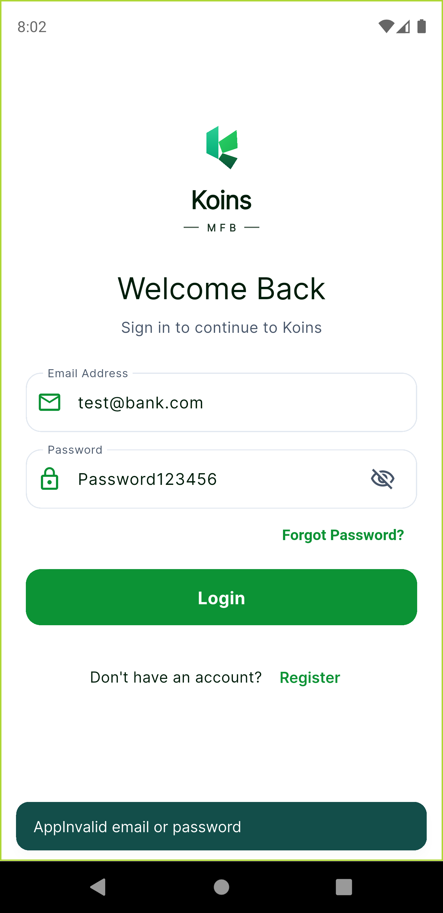
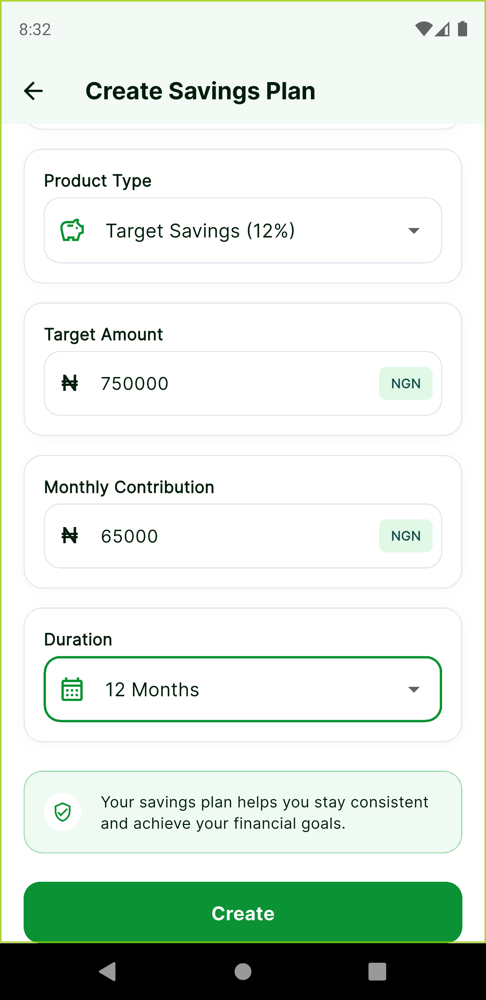

# Koins Savings App

A high-performance fintech mobile savings application built for the **Koins MFB Flutter Developer Technical Assessment**.

> **Flutter Version**: Flutter 3.29.x (Dart 3.7.x) / Stable  
> **Target Platforms**: Android (API 21+) & iOS (iOS 13+)  
> **Pre-built APK**: [Download via GitHub Releases](https://github.com/krysnkem/koins_bank_savings_app/releases/latest/download/app-release.apk) or locally at [`apk/app-release.apk`](./apk/app-release.apk)  
> **Test Coverage**: 95 Automated Unit & Widget Tests (100% Green)

---

## Table of Contents
1. [Project Overview](#project-overview)
2. [Architecture & Folder Structure Rationale](#architecture--folder-structure-rationale)
   - [Architectural Decision Record (ADR): Feature-First vs. Layer-First Structure](#architectural-decision-record-adr-feature-first-vs-layer-first-structure)
   - [Project Directory Layout](#project-directory-layout)
3. [Assessment Feature Inventory & Discovery Guide](#assessment-feature-inventory--discovery-guide)
4. [Robust Product Experience Enhancements](#robust-product-experience-enhancements)
5. [Technology Stack & Packages Used](#technology-stack--packages-used)
6. [Design System & Theming (Material 3)](#design-system--theming-material-3)
7. [State Management Rationale (Riverpod 2.0+)](#state-management-rationale-riverpod-20)
8. [Routing & Navigation (`go_router`)](#routing--navigation-go_router)
9. [Local Storage Strategy (`shared_preferences`)](#local-storage-strategy-shared_preferences)
10. [Abstracted Database Architecture & SQLite (`sqflite`)](#abstracted-database-architecture--sqlite-sqflite)
11. [REST API Integration (DummyJSON Posts)](#rest-api-integration-dummyjson-posts)
12. [Mock Authentication & Test Credentials](#mock-authentication--test-credentials)
13. [Testing & Quality Assurance (95 Tests)](#testing--quality-assurance-95-tests)
14. [Setup & Build Instructions](#setup--build-instructions)
15. [Screenshots & Visual Showcase](#screenshots--visual-showcase)
16. [Assumptions & Future Improvements](#assumptions--future-improvements)
17. [Assessment Deliverables Checklist](#assessment-deliverables-checklist)

---

## Project Overview

The **Koins Savings App** is designed for digital banking customers to manage savings goals, inspect interest-yielding products, and monitor their financial progress.

### Core Capabilities
- **Authentication**: Secure login with instant RFC 5322 email regex and $\ge 8$-character password validation, password visibility toggling, and non-functional Forgot Password/Register stubs.
- **Financial Dashboard**: Time-of-day personalized greeting (`"Good Morning, John Doe"`), total savings balance card with animated character-by-character ticker (`₦850,000`), quick action buttons, and up to 3 recent savings plans.
- **Savings Products**: 4 tiered savings products (*Target Savings*, *Fixed Deposit*, *Education Savings*, *Vacation Savings*) displaying names, annual interest rates (8%–18%), descriptions, minimum opening deposits, and tenures.
- **Product Details**: Comprehensive breakdown of product benefits, interest rates, minimum deposits, and direct CTA to create a plan.
- **Create Savings Plan**: Form with 5 required fields (Plan Name, Product Type Dropdown, Target Amount, Monthly Contribution, Duration Dropdown), client-side validation, instant write to disk and database, animated success feedback (`"Savings Created Successfully"`), and navigation back to Dashboard.
- **User Profile & Security**: Customer full name, email, phone number, and a secure Logout action that clears the session and returns to Login.
- **Public Mock REST API**: Live network consumption of `https://dummyjson.com/posts?limit=3` presented under **"Posts from Dummy JSON"** with tag badges, view counters, skeleton shimmers, and error/retry states.

---

## Architecture & Folder Structure Rationale

### Architectural Decision Record (ADR): Feature-First vs. Layer-First Structure

The assessment brief proposed the following traditional **layer-first** folder structure:

```
lib/ 
├── core/ 
├── models/ 
├── services/ 
├── repositories/ 
├── screens/ 
├── widgets/ 
├── utils/ 
├── providers/ 
└── main.dart 
```

While suitable for simple single-flow prototypes, this project deliberately chose a **Modular Feature-First Clean Architecture** (`lib/features/{auth, dashboard, products, savings}/...`).

#### Rationale & Engineering Justification:

1. **Promoting Modularity & Scalability**:
   - In a layer-first structure, as an application scales to 20+ screens, folders like `screens/`, `models/`, and `providers/` become massive dumping grounds containing hundreds of loosely related files.
   - In **Feature-First Architecture**, every functional capability (Authentication, Financial Dashboard, Savings Products, Savings Plan Creation) is treated as a self-contained module containing its own UI (`presentation/screens`, `presentation/widgets`), business logic (`presentation/notifiers`, `presentation/states`), and data contracts (`data/models`, `data/datasources`, `data/repositories`).
   - Feature modules function as independent bounded contexts that can be built, tested, refactored, or even extracted into standalone Dart packages or micro-apps without unintended side-effects across the app.

2. **Strict Separation of Concerns & High Cohesion**:
   - **High Cohesion**: All code that changes together for a single business capability lives together. When maintaining or refactoring the savings creation flow, engineers never need to jump across 6 separate, distant folders.
   - **Low Coupling**: Features interact exclusively through explicit boundaries, contracts, and services, preventing cross-cutting spaghetti dependencies.

3. **Domain-Specific vs. Shared Core Boundaries**:
   - Shared design tokens (`AppColors`, `AppRadius`, `AppTheme`), network checkers, error hierarchies, formatters, and universal UI primitives (e.g. `AppButton`, `AppTextField`, `AppShimmer`) reside cleanly in `lib/core/` and `lib/widgets/common/`.
   - Feature-specific business rules remain isolated inside their feature package.

4. **1-to-1 Test Suite Alignment**:
   - The test directory structure (`test/unit/features/...` and `test/widget/features/...`) directly mirrors `lib/features/...`. Discovering tests, writing unit coverage, and verifying regression safety is intuitive and immediate for any engineer or automated CI/CD pipeline.

### Project Directory Layout

```
lib/
├── core/
│   ├── constants/             # AppConstants, LatencyConstants
│   ├── errors/                # AppException hierarchy (AuthException, NetworkException, ServerException)
│   ├── network/               # NetworkChecker abstraction & connectivity implementation
│   ├── router/                # go_router declarative routing:
│   │   ├── app_router.dart    # StatefulShellRoute.indexedStack & route declarations
│   │   └── main_shell_screen.dart # Persistent bottom navigation shell
│   ├── session/               # UiSession presentation state & mock seeds
│   ├── theme/                 # Centralized Design System:
│   │   ├── app_colors.dart    # Strict brand color tokens (#0B9234 emerald green)
│   │   ├── app_radius.dart    # Tokenized border radius definitions
│   │   ├── app_shadows.dart   # Elevation & card shadow definitions
│   │   ├── app_spacing.dart   # Standard layout spacing grid
│   │   ├── app_text_styles.dart # Fintech typography hierarchy (Inter font)
│   │   └── app_theme.dart     # Material 3 ThemeData configuration
│   └── utils/                 # Validators, formatters (Naira ₦, percentages, greetings)
├── features/
│   ├── auth/                  # Authentication & Profile domain
│   │   ├── data/              # AuthUser model, local/remote datasources, repository
│   │   └── presentation/      # LoginScreen, ProfileScreen, auth providers
│   ├── dashboard/             # Financial dashboard domain
│   │   ├── data/              # DummyPost model, posts datasource, dashboard repository
│   │   └── presentation/      # DashboardScreen, widgets, dashboard & posts providers
│   ├── products/              # Savings Products domain
│   │   ├── data/              # SavingsProduct model, datasource, repository
│   │   └── presentation/      # ProductsScreen, ProductDetailsScreen, ProductCard
│   └── savings/               # Savings Plan creation & management domain
│       ├── data/              # SavingsPlan model, local/remote datasources, repository
│       └── presentation/      # CreateSavingsScreen, SavingsPlansScreen
├── services/                  # BackendService contract & MockBackendService implementation
│   ├── database/              # Abstract DatabaseService, SqfliteDatabaseService, AppDatabase
│   └── storage/               # SharedPreferencesService contract & implementation
├── repositories/              # Repository exports & contracts
├── widgets/
│   ├── common/                # Reusable UI components (buttons, input fields, error states, shimmer)
│   └── savings/               # Reusable savings domain cards & status chips
└── main.dart                  # Application entry point & Riverpod ProviderScope
```

---

## Assessment Feature Inventory & Discovery Guide

Every functional and technical requirement outlined in the **Koins MFB Assessment Specification** has been fully implemented. Below is the discovery guide detailing where each feature lives in the codebase and how to test and interact with it in the application:

| # | Assessment Requirement | Implementation Files | App Route / Screen | How to Discover & Interact |
| :---: | :--- | :--- | :--- | :--- |
| **1** | **Login Screen & Validation**<br>• Email & Password fields<br>• Login Button<br>• Non-functional Forgot Password & Register stubs<br>• Required & regex format email validation<br>• Required & $\ge 8$ char password validation<br>• Mock auth (`test@bank.com` / `Password123`) | [login_screen.dart](file:///Users/Chris/magic/koins_savings_app/lib/features/auth/presentation/screens/login_screen.dart)<br>[login_notifier.dart](file:///Users/Chris/magic/koins_savings_app/lib/features/auth/presentation/notifiers/login_notifier.dart) | `/login` (Initial launch route) | • Launch the app (or log out from Profile).<br>• Tap **"Auto-fill Test Credentials"** for 1-tap instant testing, or manually type `test@bank.com` & `Password123`.<br>• Test inline validations by entering invalid emails or short passwords.<br>• Toggle password visibility via the eye icon.<br>• Tap "Forgot Password" or "Register" to verify non-functional feedback stubs. |
| **2** | **Dashboard Screen**<br>• Personalized greeting ("Good Morning, John Doe")<br>• Total Savings (₦850,000)<br>• Quick actions (Create Savings, View Products)<br>• 3 Recent Savings plans (Emergency Fund, ₦120,000, Monthly) | [dashboard_screen.dart](file:///Users/Chris/magic/koins_savings_app/lib/features/dashboard/presentation/screens/dashboard_screen.dart)<br>[dashboard_notifier.dart](file:///Users/Chris/magic/koins_savings_app/lib/features/dashboard/presentation/notifiers/dashboard_notifier.dart) | `/dashboard` (Tab 0 of Persistent Shell) | • Lands here immediately after login.<br>• Observe dynamic time-of-day greeting.<br>• Watch the animated rolling ticker count up to `₦850,000`.<br>• Tap "Create Savings" quick action to launch the creation modal.<br>• Tap "Explore Products" to jump to Products tab.<br>• Inspect the 3 recent savings cards with plan names, amounts, and frequencies.<br>• Swipe down to test native pull-to-refresh. |
| **3** | **Savings Products Screen**<br>• 4 Products (*Target Savings*, *Fixed Deposit*, *Education Savings*, *Vacation Savings*)<br>• Interest rates (8%–18%) & tenures<br>• Product name, short description, "View Details" CTA | [savings_products_screen.dart](file:///Users/Chris/magic/koins_savings_app/lib/features/products/presentation/screens/savings_products_screen.dart)<br>[product_card.dart](file:///Users/Chris/magic/koins_savings_app/lib/features/products/presentation/widgets/product_card.dart) | `/products` (Tab 1 "Explore" of Shell) | • Tap **"Explore"** in bottom navigation (or "Explore Products" on Dashboard).<br>• Displays all 4 tiered interest-bearing products with badges, annual interest rates, and descriptions.<br>• Tap "View Details" on any product to navigate to its dedicated detail view. |
| **4** | **Savings Details Screen**<br>• Product Name, Interest Rate, Minimum Deposit (₦5,000), Duration<br>• "Create Savings" direct CTA | [product_details_screen.dart](file:///Users/Chris/magic/koins_savings_app/lib/features/products/presentation/screens/product_details_screen.dart) | `/product/:id` (e.g. `/product/target-savings`) | • Tap any product card from the Explore Products list.<br>• Inspect the full benefits, minimum deposit requirement, interest rate, and terms.<br>• Tap **"Create Savings Plan"** to launch the creation flow with this product pre-selected. |
| **5** | **Create Savings Screen**<br>• 5 Required fields: Savings Name, Product Type (Dropdown), Target Amount, Monthly Contribution, Duration (Dropdown)<br>• All fields required validation<br>• On Success: "Savings Created Successfully"<br>• Return to Dashboard | [create_savings_screen.dart](file:///Users/Chris/magic/koins_savings_app/lib/features/savings/presentation/screens/create_savings_screen.dart)<br>[create_savings_notifier.dart](file:///Users/Chris/magic/koins_savings_app/lib/features/savings/presentation/notifiers/create_savings_notifier.dart) | `/create` (Full-screen modal over shell) | • Tap "Create Savings" on Dashboard quick actions or the green `(+)` button on My Savings.<br>• Observe real-time currency formatting with thousands separators as you type.<br>• Submit with empty fields to verify inline validation.<br>• Complete fields and tap "Create Savings Plan": verifies green "Savings Created Successfully" SnackBar, immediate SQLite & SharedPreferences write, and seamless return to Dashboard. |
| **6** | **My Savings / Active Plans Screen**<br>• Active savings plans portfolio overview<br>• Total target goal vs. current accumulated<br>• Plan cards with progress bars and contribution frequency | [savings_plans_screen.dart](file:///Users/Chris/magic/koins_savings_app/lib/features/savings/presentation/screens/savings_plans_screen.dart)<br>[savings_plan_card.dart](file:///Users/Chris/magic/koins_savings_app/lib/widgets/savings/savings_plan_card.dart) | `/my-savings` (Tab 2 "My Savings" of Shell) | • Tap **"My Savings"** in the bottom navigation (or "View All" on Dashboard).<br>• Displays total target goal (₦3,500,000), current accumulated (₦550,000), and all 5 active savings plans with linear progress indicators (0% to 24% reached).<br>• Tap the top-right green `(+)` icon to create an additional savings plan. |
| **7** | **Profile Screen & Logout**<br>• Full Name, Email, Phone Number<br>• Working Logout Button returning to Login | [profile_screen.dart](file:///Users/Chris/magic/koins_savings_app/lib/features/auth/presentation/screens/profile_screen.dart) | `/profile` (Tab 3 "More" of Shell) | • Tap **"More"** in the bottom navigation.<br>• Displays customer avatar, full name (John Doe), email (`test@bank.com`), and phone number (`+234 801 234 5678`).<br>• Tap **"Log Out"**: verifies disk session clearance in `shared_preferences` and immediate navigation back to `/login`. |
| **8** | **REST API Integration**<br>• Public mock API (`dummyjson.com`)<br>• Live dataset consumption & display | [dummy_posts_repository.dart](file:///Users/Chris/magic/koins_savings_app/lib/features/dashboard/data/repositories/dummy_posts_repository.dart)<br>[dashboard_posts_section.dart](file:///Users/Chris/magic/koins_savings_app/lib/features/dashboard/presentation/widgets/dashboard_posts_section.dart) | `/dashboard` (Bottom section) | • Scroll down on the Dashboard below Recent Savings Plans.<br>• Displays live posts fetched from `https://dummyjson.com/posts?limit=3` under **"Posts from Dummy JSON"**.<br>• Inspect tag badges, view counters, shimmer skeleton loading during fetch, and error retry state if offline. |
| **9** | **Local Storage Strategy**<br>• Persist logged-in user<br>• Persist created savings plans<br>• `shared_preferences` & SQLite | [shared_prefs_service.dart](file:///Users/Chris/magic/koins_savings_app/lib/services/storage/shared_prefs_service.dart)<br>[app_database.dart](file:///Users/Chris/magic/koins_savings_app/lib/services/database/app_database.dart) | Disk & Database Layer | • Log in, create a savings plan, and kill/restart the app.<br>• The user session persists seamlessly, and created plans remain saved in both SQLite `savings_plans` and JSON-serialized SharedPreferences. |

---

## Robust Product Experience Enhancements

Beyond the baseline requirements in the assessment brief, several enterprise-grade engineering enhancements were incorporated to ensure a resilient, delightful, and robust fintech user experience:

1. **Staggered Animated Rolling Number Counter**:
   - The total savings balance (`₦850,000`) on the dashboard doesn't just appear statically; it features a custom, staggered rolling-digit animation implemented in [`StaggeredRollingNumber`](file:///Users/Chris/magic/koins_savings_app/lib/widgets/common/staggered_rolling_number.dart). Digits roll into place sequentially from left to right, providing immediate visual feedback of active financial calculation.

2. **Persistent Bottom Navigation Shell (`go_router`)**:
   - Configured with `StatefulShellRoute.indexedStack` ([MainShellScreen](file:///Users/Chris/magic/koins_savings_app/lib/core/router/main_shell_screen.dart)). Unlike standard `BottomNavigationBar` setups that recreate screens on tap, this architecture maintains separate navigation stacks for all 4 tabs. Users never lose their scroll position or intermediate form input when switching between tabs.

3. **Dynamic Real-Time Naira Input Formatter (`NairaInputFormatter`)**:
   - Built a custom `TextInputFormatter` ([`naira_input_formatter.dart`](file:///Users/Chris/magic/koins_savings_app/lib/core/utils/naira_input_formatter.dart)) for currency inputs. It automatically formats numbers with Nigerian Naira formatting and comma-grouping (e.g. typing `100000` automatically renders `₦100,000`), accurately adjusting text selection cursors to prevent input jumps.

4. **Strict Sealed Class UI States & Zero `setState`**:
   - Follows modern Riverpod 2.0+ sealed class hierarchies (`Initial`, `Loading`, `Loaded`, `Error`). Every UI component uses compile-time exhaustive pattern matching. Zero screen widgets invoke `setState()`, eliminating race conditions, UI flickering, and loose boolean flags (`isLoading = true`).

5. **Fault-Tolerant Network Segregation**:
   - External mock REST API consumption (`https://dummyjson.com/posts?limit=3`) is cleanly segregated from internal banking database queries. If the external internet connection drops or DummyJSON throttles requests, local banking operations (checking balances, viewing plans, creating new savings) continue functioning completely unimpeded.

6. **Animated Shimmer Skeletons (`AppShimmer`)**:
   - Replaced basic circular progress spinners with custom grey-to-silver shimmer skeleton loaders ([`app_shimmer.dart`](file:///Users/Chris/magic/koins_savings_app/lib/widgets/common/app_shimmer.dart)) matching the exact geometry of cards and post items for fluid perceived performance.

7. **Native Pull-to-Refresh**:
   - Integrated `RefreshIndicator` on the Dashboard screen. Swiping down dispatches background refreshes to recalculate account balances, re-query recent plans from SQLite, and re-fetch live DummyJSON posts with tactile haptic feedback.

8. **One-Tap Test Credential Auto-Fill**:
   - Added an evaluator convenience button on the Login screen that automatically populates the assessment's test credentials (`test@bank.com` / `Password123`) in a single tap, speeding up manual testing.

9. **Comprehensive 95-Test Automated Suite**:
   - Authored 95 automated unit and widget tests covering all repositories, sealed state transitions, validation formatters, screen renders, and form submissions with a 100% green pass rate.

---

## Technology Stack & Packages Used

The application utilizes production-grade libraries from the Flutter ecosystem:

| Package | Version | Purpose & Architectural Justification |
| :--- | :--- | :--- |
| **`flutter_riverpod`** | `^2.6.1` | Modern reactive state management without BuildContext coupling; enforces sealed classes and auto-disposable notifiers. |
| **`go_router`** | `^17.5.0` | Declarative routing supporting `StatefulShellRoute.indexedStack` for persistent multi-tab state preservation and deep linking. |
| **`shared_preferences`** | `^2.5.6` | Persistent key-value storage on disk for user sessions and offline savings plans JSON cache. |
| **`sqflite`** | `^2.4.4+2` | Embedded SQLite database on Android and iOS backing the mock backend service. |
| **`sqflite_common_ffi`** | `^2.4.4` | Headless SQLite FFI driver enabling in-memory isolated unit testing on desktop/CI environments. |
| **`http`** | `^1.2.2` | Composable HTTP client used to fetch live data from the public DummyJSON REST API. |
| **`google_fonts`** | `^6.2.1` | Typographic design system loading Google's `Inter` font family for fintech UI clarity. |
| **`intl`** | `^0.19.0` | Locale-aware currency formatting (`₦`), date parsing, and number grouping. |
| **`connectivity_plus`** | `^6.1.4` | Network status monitoring powering the `NetworkChecker` abstraction. |
| **`flutter_lints`** | `^5.0.0` | Recommended static analysis and style rules for Flutter and Dart codebases. |

---

## Design System & Theming (Material 3)

The application adheres strictly to Material 3 principles with a **100% tokenized design system**:

### Color Palette
| Token | Hex | Semantic Role |
| :--- | :--- | :--- |
| `AppColors.primary` | `#0B9234` | Brand emerald green, primary action buttons, active navigation items |
| `AppColors.primaryDark` | `#076B26` | Button pressed states & dark accents |
| `AppColors.secondary` | `#0F766E` | Deep teal accents for secondary badges |
| `AppColors.background` | `#FFFFFF` | Primary canvas background |
| `AppColors.surface` | `#FFFFFF` | Card containers with subtle elevation |
| `AppColors.textPrimary` | `#111827` | Primary headlines, balance figures, and titles |
| `AppColors.textSecondary` | `#6B7280` | Subtitles, helper text, and secondary metadata |
| `AppColors.cardBorder` | `#F3F4F6` | Hairline border for elevated cards |
| `AppColors.error` | `#EF4444` | Validation error text and error state indicators |

### Elevation & Geometry Tokens
- **Border Radius**: `AppRadius.input` ($12\text{px}$), `AppRadius.card` ($16\text{px}$), `AppRadius.button` ($12\text{px}$), `AppRadius.pill` ($999\text{px}$).
- **Card Shadow**: `AppShadows.card` — subtle blur ($16\text{px}$) with gentle vertical offset ($4\text{px}$) and $5\%$ black opacity.
- **Elevation Glow**: `AppShadows.avatarGlow` — subtle $15\%$ primary green glow for the profile avatar.

---

## State Management Rationale (Riverpod 2.0+)

**Riverpod 2.0+** was selected over Provider, Bloc, and GetX for the following reasons:

1. **Compile-Time Safety & Zero BuildContext Coupling**:
   - Providers can be declared globally and read safely in business logic without requiring `BuildContext`.
   - Eliminates runtime `ProviderNotFoundException` issues common with standard Provider.
2. **Strict Sealed Class State Hierarchies**:
   - All feature states are modeled as sealed classes (e.g. `sealed class PostsState: PostsInitial, PostsLoading, PostsLoaded, PostsError`).
   - Ensures pattern-matching exhaustiveness at compile time and eliminates loose boolean loading flags.
3. **Automatic Lifecycle Management (`autoDispose`)**:
   - Screen-bound states use `AutoDisposeNotifier`, ensuring resources and controllers are cleanly released when navigating away.
4. **Zero `setState` on Screens**:
   - Screen widgets are strictly `ConsumerWidget` or `ConsumerStatefulWidget` (used exclusively for controller lifecycle disposal). All state changes flow through Riverpod notifiers.
5. **Clean Unit & Widget Testability**:
   - Riverpod `ProviderScope` allows overriding any provider or repository using `overrideWithValue` during testing without needing complex mock wrappers.

---

## Routing & Navigation (`go_router`)

Declarative navigation is configured using Flutter's Router API via `go_router`:

- **Stateful Bottom Navigation Shell**:
  - Employs `StatefulShellRoute.indexedStack` with [MainShellScreen](file:///Users/Chris/magic/koins_savings_app/lib/core/router/main_shell_screen.dart).
  - Preserves 4 independent navigation branches (`Dashboard`, `Savings / Products`, `My Savings`, `More / Profile`).
  - Switching between tabs maintains scroll offsets, form inputs, and loaded states without rebuilds.
- **Full-Screen Modal Overlays**:
  - Routes like **Create Savings Plan** (`/create`) and **Product Details** (`/product/:id`) specify `parentNavigatorKey: rootNavigatorKey`, sliding over the bottom navigation bar for an immersive flow.
- **Deep Linking Support**:
  - Declarative routes: `/dashboard`, `/products`, `/my-savings`, `/profile`, `/create`, `/product/:id`.

---

## Local Storage Strategy (`shared_preferences`)

To fulfill the assessment's local persistence mandate, the application uses **`shared_preferences`** for real disk storage:

1. **User Authentication Session**:
   - `AuthLocalDataSource` persists user session data (email, name, phone, logged-in flag) across application restarts.
2. **Created Savings Plans**:
   - `SavingsLocalDataSource` serializes user-created savings plans into JSON under the storage key `'saved_savings_plans'`.
   - When a user submits the Create Savings form, the plan is immediately persisted to disk and displayed on the Dashboard and My Savings screens.

---

## Abstracted Database Architecture & SQLite (`sqflite`)

To eliminate code-level hardcoding and simulate realistic network calls against a persistent data store, all core banking records are managed via an **Abstracted Database Service** backed by **SQLite** (`sqflite` on mobile and `sqflite_common_ffi` for headless testing).

```
UI / Screens (ConsumerWidget)
       │
       ▼
Riverpod Notifiers (AutoDisposeNotifier)
       │
       ▼
Feature Repositories (SavingsRepository, AuthRepository, TransactionsRepository)
       │
       ▼
Backend Service Contract (BackendService / MockBackendService)
  [Simulates configurable network latency & offline checks]
       │
       ▼
Abstracted Database Service (DatabaseService)
       │
       ▼
Concrete SQLite Implementation (SqfliteDatabaseService -> AppDatabase)
  [Tables: users, savings_products, savings_plans, transactions]
```

### Managed Tables & Schema (Scoped to `test@bank.com`)

1. **`users` Table**: Authenticated customer account data (`id`, `email`, `password`, `full_name`, `phone`, `avatar_initials`, `created_at`).
2. **`savings_products` Table**: 4 pre-seeded interest-bearing products (`id`, `name`, `interest_rate`, `duration`, `short_description`, `minimum_deposit`, `icon_key`, `is_active`).
3. **`savings_plans` Table**: Active savings plans created for `test@bank.com` (`id`, `user_email`, `product_id`, `product_name`, `name`, `amount`, `target_amount`, `monthly_contribution`, `frequency`, `duration`, `status`, `created_at`).
4. **`transactions` Table**: Ledger of savings deposits, payouts, and contributions (`id`, `user_email`, `plan_id`, `title`, `category`, `amount`, `is_credit`, `status`, `date_label`, `icon_key`, `created_at`).

---

## REST API Integration (DummyJSON Posts)

The technical assessment mandates integrating a public mock REST API:

- **Endpoint**: `https://dummyjson.com/posts?limit=3`
- **Dashboard Section**: Displayed prominently under **"Posts from Dummy JSON"** with an official `REST API` pill badge.
- **Pure Network Consumption**: Fetched directly via `http.Client` inside `MockBackendService.getPosts()`, completely decoupled from local database storage.
- **Resilience & UX**:
  - **Loading**: Skeleton shimmer card animations while data is loading.
  - **Success**: Post cards displaying the post title, snippet body, tags chips, and view counters.
  - **Error & Offline**: Graceful error card with a one-tap **"Retry"** button when network fails or when `forceOffline` is active.

---

## Mock Authentication & Test Credentials

Use the following assessment credentials to log in:

```
Email:    test@bank.com
Password: Password123
```

- **Validation Rules**:
  - Email: Required, must match standard RFC 5322 regex.
  - Password: Required, minimum 8 characters.
  - Visibility: Interactive eye icon to toggle password obfuscation.

---

## Testing & Quality Assurance (95 Tests)

The repository features comprehensive automated test coverage across all layers:

### Static Analysis
```bash
fvm flutter analyze
# Output: No issues found! (0 warnings, 0 errors)
```

### Automated Test Suite
**95 automated unit and widget tests** passing at 100%:

```bash
fvm flutter test
# Output: 00:08 +95: All tests passed!
```

### Test Coverage Highlights:
- **Navigation & Routing**: Shell branch key integrity, modal overlay navigation, and URL addressability.
- **REST API & Mock Backend**: Live HTTP parsing from DummyJSON, status code failure handling, offline exception propagation.
- **Database & Persistence**: SQLite CRUD operations (`SqfliteDatabaseService`, `AppDatabase`), schema upgrade migrations, and `SharedPreferences` session/plan persistence.
- **Widget Flow Tests**:
  - `CreateSavingsScreen`: Filling out all 5 inputs, selecting dropdown options, verifying disk write, and confirming snackbar presentation.
  - `DashboardScreen`: Independent componentized section mounting, loading shimmer verification, and greeting validation.
  - `LoginScreen`: Form validation, credential checking, and password visibility toggling.
  - `SavingsPlansScreen` & `ProductDetailsScreen`: Portfolio rendering and product details verification.
- **Validators & Formatters**: RFC 5322 regex, password length ($\ge 8$), positive Naira currency formatting (`₦`), and percentage formatting.
- **Animations**: `FadeEntry` opacity animation tests and `StaggeredRollingNumber` character ticker tests.

---

## Setup & Build Instructions

### Prerequisites
- **Flutter SDK**: `3.29.x` or later (Stable)
- **Dart SDK**: `3.7.x` or later
- **FVM** (optional, recommended): `fvm` configured via `.fvmrc`

### Step-by-Step Setup
```bash
# 1. Clone repository
git clone https://github.com/krysnkem/koins_bank_savings_app.git
cd koins_bank_savings_app

# 2. Get dependencies
fvm flutter pub get

# 3. Verify static analysis
fvm flutter analyze

# 4. Run test suite
fvm flutter test

# 5. Run on connected emulator or device
fvm flutter run
```

### APK Binaries & GitHub Releases
A pre-built production release APK is provided for evaluators:
- **GitHub Release Direct Download**: [app-release.apk (Latest v1.0.0)](https://github.com/krysnkem/koins_bank_savings_app/releases/latest/download/app-release.apk)
- **GitHub Releases Page**: [https://github.com/krysnkem/koins_bank_savings_app/releases](https://github.com/krysnkem/koins_bank_savings_app/releases)
- **Local Repository Asset**: [`apk/app-release.apk`](./apk/app-release.apk) (~58 MB production release, tree-shaken)
- **Build Output Path**: `build/app/outputs/flutter-apk/app-release.apk`

To compile binaries locally:
```bash
# Release APK (Optimized & tree-shaken)
fvm flutter build apk --release

# Debug APK
fvm flutter build apk --debug
```

---

## Screenshots & Visual Showcase

### Persistent Shell & Tab Navigation (`go_router`)
| 1. Dashboard Tab | 2. Savings Products Tab | 3. My Savings (Active Goals) | 4. More / Profile Tab |
| :---: | :---: | :---: | :---: |
|  |  |  |  |

### Form Flows & Interactive States
| 5. Create Savings Plan | 6. Duration Dropdown Open | 7. Plan Created Feedback | 8. Login Authentication |
| :---: | :---: | :---: | :---: |
|  |  |  |  |

---

## Assumptions & Future Improvements

### Assumptions
1. **Mock Authentication**: Evaluated against in-memory session persistence and SQLite user records as specified in the assessment guidelines.
2. **Currency & Localization**: Scoped to Nigerian Naira (`₦`) with comma thousands-separators.
3. **Device Form Factor**: Optimized for portrait mobile viewports across standard iOS and Android screen resolutions.

### Future Improvements (Given More Time)

1. **Interactive Savings Funding & Transfer Simulation Screen (Directly from "My Savings")**:
   - **Direct Transfer Simulation**: Add a dedicated **"Transfer / Deposit Funds"** modal flow accessible directly from the **My Savings** screen.
   - **Inflow to Koins App**: Simulate instant inter-bank or debit card transfers directly into the customer's Koins savings wallet, crediting their account.
   - **Goal-Specific Funding Allocation**: Enable users to select any active savings plan (e.g. *American Savings*, *Emergency Fund*, or *House Savings Plan*) and allocate simulated deposits toward that goal.
   - **Dynamic Portfolio Recalculation**:
     - Automatically recalculates the **"Current Accumulated"** portfolio counter in real time (e.g., advancing from ₦550,000 toward the ₦3,500,000 total target goal).
     - Dynamically updates the linear progress indicator and percentage badge (e.g., advancing from 0% to 24%, 50%, or 100% reached).
     - Persists an immutable transaction record in the SQLite `transactions` table (with category *Deposit / Transfer*, timestamp, and credit status).
   - **Interest & Yield Simulation**: Real-time projection calculator showing accumulated annual interest earnings based on product rates (8%–18% p.a.) over the selected tenure.

2. **Biometric & PIN Authentication**: Integrate `local_auth` for Face ID, Touch ID, and custom PIN entry.
3. **Comprehensive Dark Mode**: Implement dark color palette tokens within `AppTheme` with auto system detection.
4. **Product Search & Filtering**: Add search bar filtering and interest rate sorting on the Savings Products screen.
5. **End-to-End Integration Tests**: Add Flutter Driver / `integration_test` automation testing full multi-screen user onboarding flows.

---

## Assessment Deliverables Checklist

- [x] **Login Screen**: Email, Password, validation (required, format, min 8 chars), mock auth, Forgot Password & Register stubs.
- [x] **Dashboard Screen**: Dynamic time greeting, ₦850,000 balance with ticker animation, quick actions, 3 recent plans.
- [x] **Savings Products Screen**: 4 tiered products (*Target Savings*, *Fixed Deposit*, *Education Savings*, *Vacation Savings*) with interest rates and tenures.
- [x] **Savings Details Screen**: Overview of minimum deposit (₦5,000), interest rate, duration, and direct Create Savings navigation.
- [x] **Create Savings Screen**: 5 required fields, dropdowns, validation, local storage write, and `"Savings Created Successfully"` snackbar.
- [x] **Profile Screen**: Full Name, Email, Phone Number, and working Logout returning to Login.
- [x] **REST API Integration**: Direct HTTP network integration with `https://dummyjson.com/posts?limit=3` under **"Posts from Dummy JSON"** with loading shimmers and error retry.
- [x] **Local Storage**: `shared_preferences` session persistence and created savings plans JSON serialization.
- [x] **Database Architecture**: Abstracted `DatabaseService` backed by SQLite (`sqflite`) for core banking data.
- [x] **State Management**: Riverpod 2.0+ Notifiers with sealed class state hierarchies and zero `setState` on screens.
- [x] **Design System & Material 3**: 100% tokenized color palette, radius, spacing, typography (Inter), and elevation.
- [x] **Automated Tests**: 95 automated unit and widget tests passing with 100% green bar.
- [x] **Static Analysis**: `flutter analyze` with 0 warnings and 0 errors.
- [x] **Pre-built APK**: Available at [`apk/app-release.apk`](./apk/app-release.apk) and on [GitHub Releases](https://github.com/krysnkem/koins_bank_savings_app/releases).
- [x] **Comprehensive README**: Architecture explanation, setup guide, packages table, assumptions, future improvements, and screenshots showcase.
