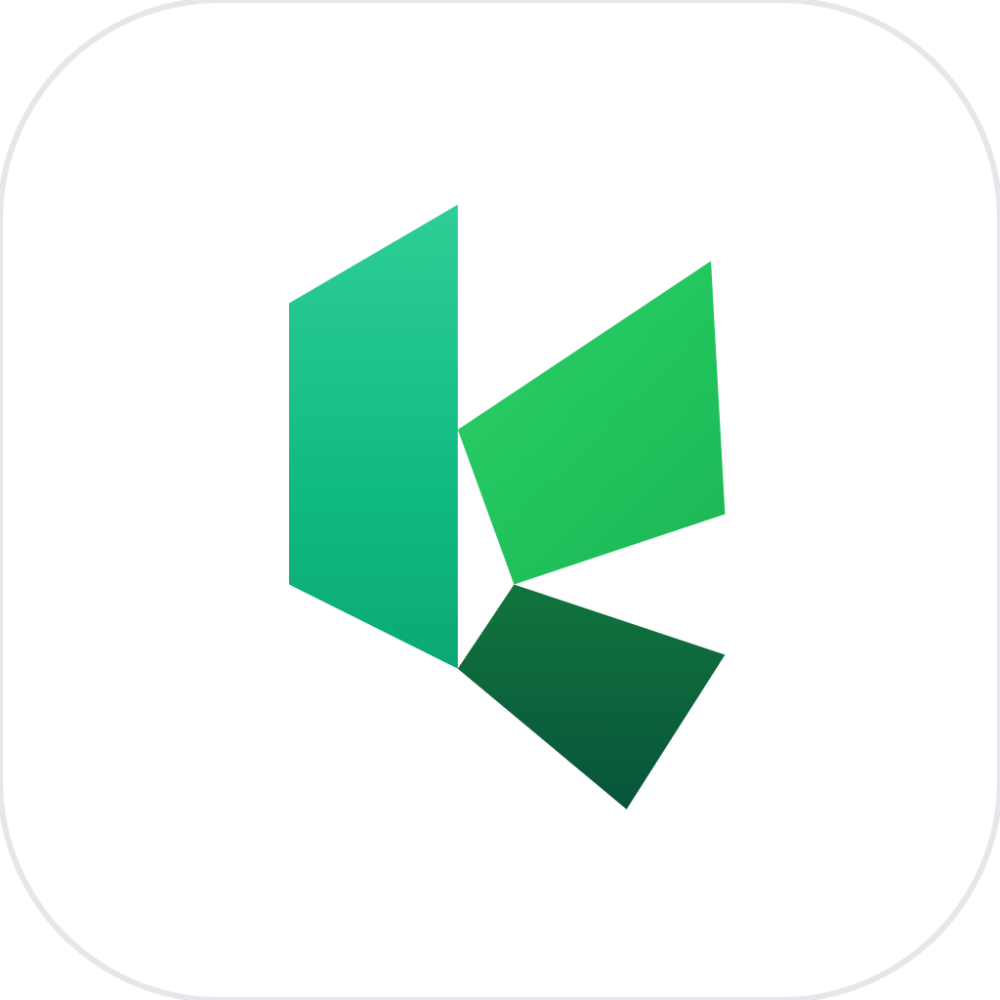
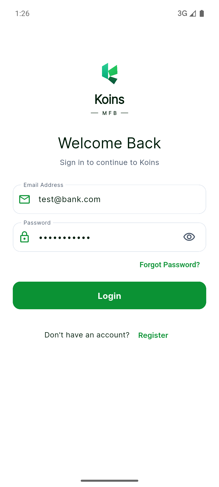
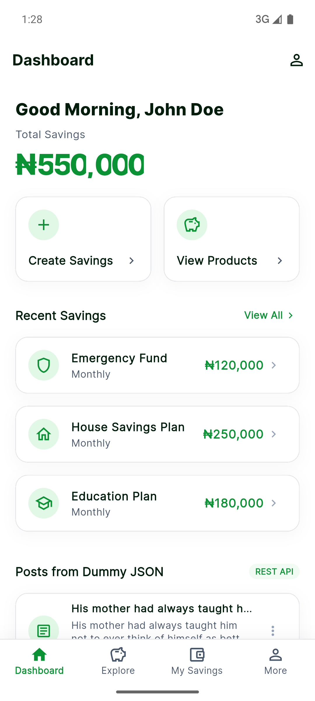
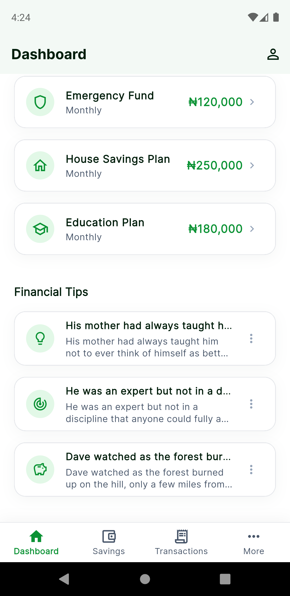
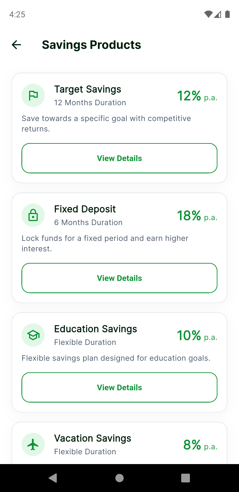
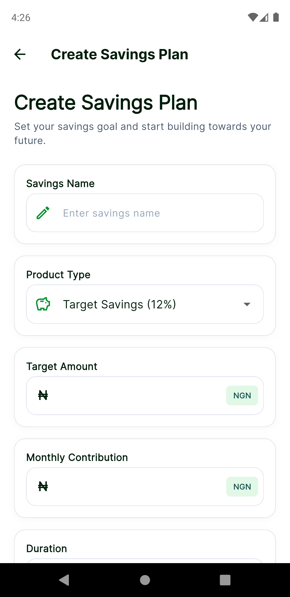
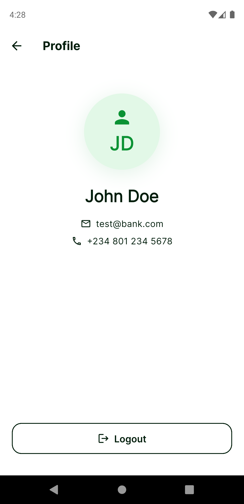

<p align="center">
  
</p>

# Koins Savings App

A high-performance fintech mobile savings application built for the **Koins MFB Flutter Developer Technical Assessment**.

> **Flutter Version**: Flutter 3.29.x (Dart 3.7.x)  
> **Pre-built APK**: [Download via GitHub Releases](https://github.com/krysnkem/koins_bank_savings_app/releases/latest/download/app-release.apk) or locally at [`apk/app-release.apk`](./apk/app-release.apk)  
> **Test Suite**: 111 Automated Unit & Widget Tests (100% Passing)

---

## App Showcase

| Login Screen | Financial Dashboard | DummyJSON REST API | Explore Products |
| :---: | :---: | :---: | :---: |
|  |  |  |  |

| Product Details | Create Savings Plan | My Savings Portfolio | User Profile & Logout |
| :---: | :---: | :---: | :---: |
|  |  |  |  |

---

## Development Approach: Spec-Driven Development (SDD)

Development followed **Spec-Driven Development (SDD)**: requirements were drafted into technical specifications before writing code.

1. **Contract-First Modeling**: Abstract interfaces (`DatabaseService`, `BackendService`, `SharedPreferencesService`) and domain models were specified before building concrete implementations.
2. **Sealed State Machines**: Every screen's lifecycle was modeled using sealed class hierarchies (`Initial`, `Loading`, `Loaded`, `Error`), eliminating loose boolean flags (`isLoading`) and enforcing compile-time exhaustive pattern matching.
3. **Specification Verification**: All specified constraints (validation regexes, calculations, SQLite persistence, and UI rendering) were codified into automated unit and widget tests before final delivery.

---

## Architecture & Folder Structure

### Why Feature-First over Layer-First Structure?

The assessment prompt suggested a traditional layer-based folder structure (`lib/{models, screens, services, repositories, widgets}`). We opted for a **Modular Feature-First Clean Architecture** (`lib/features/...`) for three practical reasons:

- **Modularity & Scalability**: Each feature (Authentication, Dashboard, Products, Savings) operates as a self-contained module containing its own UI, state notifiers, models, and data sources.
- **Separation of Concerns & High Cohesion**: Code that changes together lives together. Maintaining or refactoring the savings creation flow does not touch authentication or dashboard logic.
- **Clear Shared Boundaries**: Universal design tokens, formatters, network checkers, error handlers, and UI primitives live cleanly in `lib/core/` and `lib/widgets/common/`.
- **Mirror Test Suite**: The test directory (`test/unit/features/...` and `test/widget/features/...`) directly mirrors `lib/features/...`, keeping test discovery effortless.

```
lib/
├── core/
│   ├── constants/             # AppConstants, timing, seeds
│   ├── errors/                # AppException hierarchy & Centralized ErrorHandler
│   ├── network/               # NetworkChecker abstraction
│   ├── router/                # go_router declarative routing & shell navigation
│   ├── theme/                 # Design tokens (AppColors, AppRadius, AppTheme)
│   └── utils/                 # Validators, formatters (Naira ₦, percentage)
├── features/
│   ├── auth/                  # Login, user profile, auth repository & notifiers
│   ├── dashboard/             # Balance summary, quick actions, DummyJSON posts
│   ├── products/              # 4 savings products, product details screen
│   └── savings/               # Create savings plan, portfolio overview & plan cards
├── services/
│   ├── database/              # Abstract DatabaseService & SqfliteDatabaseService
│   └── storage/               # SharedPreferencesService & session persistence
├── widgets/
│   ├── common/                # AppButton, AppTextField, AppShimmer, ErrorState
│   └── savings/               # SavingsPlanCard, ProductCard
└── main.dart                  # App bootstrap & ProviderScope
```

---

## Assessment Features & Discovery

All requirements specified in the technical assessment have been implemented:

| # | Feature | Screen / Route | Implementation & Discovery |
| :-: | :--- | :--- | :--- |
| **1** | **Login & Validation** | `/login` | • Email (RFC 5322 regex) & Password ($\ge 8$ characters) validation.<br>• Password visibility toggle.<br>• Non-functional "Forgot Password" and "Register" stubs.<br>• Test credentials: `test@bank.com` / `Password123` (or tap **"Auto-fill Test Credentials"**). |
| **2** | **Financial Dashboard** | `/dashboard` | • Dynamic time-based greeting (*"Good Morning, John Doe"*).<br>• Total savings balance (₦550,000) with animated rolling counter.<br>• Quick action cards (*"Create Savings"*, *"View Products"*).<br>• 3 recent savings plans with progress and contribution details. |
| **3** | **Savings Products** | `/products` | • 4 tiered products (*Target Savings*, *Fixed Deposit*, *Education Savings*, *Vacation Savings*).<br>• 8% to 18% p.a. interest rates, tenures, short descriptions, and "View Details" CTA. |
| **4** | **Product Details** | `/product/:id` | • Minimum deposit (₦5,000), interest rate, duration, and direct *"Create Savings Plan"* CTA. |
| **5** | **Create Savings** | `/create` | • 5 required fields: Savings Name, Product Type (dropdown), Target Amount, Monthly Contribution, Duration (dropdown).<br>• Full validation on all fields.<br>• Green *"Savings Created Successfully"* feedback and return to Dashboard. |
| **6** | **My Savings Portfolio** | `/my-savings` | • Active savings portfolio overview (Total Target Goal vs. Current Accumulated).<br>• Active plan cards with linear progress bars (0% to 24% reached). |
| **7** | **Profile & Logout** | `/profile` | • Displays Full Name, Email, and Phone Number.<br>• Working **Log Out** button that clears local session and navigates back to Login. |
| **8** | **REST API Integration** | `/dashboard` | • Live consumption of `https://dummyjson.com/posts?limit=3` under **"Posts from Dummy JSON"**.<br>• Displays titles, snippets, tag badges, view counters, shimmer loading, and error retry state. |
| **9** | **Local Storage** | Disk & DB | • User session and created savings plans persist across app restarts using `shared_preferences` and SQLite (`sqflite`). |

---

## Out-of-Scope Production Polish

Beyond baseline requirements, the following enhancements were implemented to provide a production-grade experience:

1. **Centralized User-Friendly Error Handler (`ErrorHandler`)**:
   - Intercepts raw exceptions across network (`SocketException`, DNS failures, timeouts), SQLite database queries, and disk I/O.
   - Sanitizes technical messages into clean, actionable guidance (e.g. *"Unable to connect to the internet. Please check your network connection and try again."*) with zero stack traces leaked to users.
2. **Animated Shimmer Skeletons (`AppShimmer`)**:
   - Replaced basic circular loading spinners with grey-to-silver geometric shimmer skeletons matching the exact geometry of cards and posts.
3. **Staggered Rolling Number Counter**:
   - Financial balances animate with a smooth digit-by-digit rolling ticker on load instead of displaying statically.
4. **Real-Time Naira Input Formatter (`NairaInputFormatter`)**:
   - Currency inputs format automatically with Nigerian Naira (`₦`) symbol and comma thousands-separators as the user types without disrupting cursor placement.
5. **One-Tap Test Credential Auto-Fill**:
   - Quick-fill button on the login screen for evaluator convenience.
6. **Custom Branded Launcher & Adaptive Icons**:
   - Multi-faceted origami "K" brandmark rendered to native Android adaptive icons (`mipmap-anydpi-v26`) and iOS `AppIcon.appiconset` via `flutter_launcher_icons`.
7. **111-Test Automated Suite**:
   - 111 unit, widget, and notifier tests with 100% pass rate.

---

## Setup & Run Instructions

### Prerequisites
- **Flutter SDK**: `3.29.x` (or newer stable)
- **Dart SDK**: `3.7.x` (or newer)
- **FVM** (optional, recommended): configured via `.fvmrc`

### Commands
```bash
# 1. Clone repository
git clone https://github.com/krysnkem/koins_bank_savings_app.git
cd koins_bank_savings_app

# 2. Install dependencies
fvm flutter pub get

# 3. Run static analysis (0 warnings, 0 errors)
fvm flutter analyze

# 4. Run automated test suite (111 passed)
fvm flutter test

# 5. Run on device / emulator
fvm flutter run
```

### Pre-Built Production APK
- **GitHub Release Direct Download**: [app-release.apk](https://github.com/krysnkem/koins_bank_savings_app/releases/latest/download/app-release.apk)
- **Repository Path**: [`apk/app-release.apk`](./apk/app-release.apk)

---

## Packages Used

| Package | Version | Purpose |
| :--- | :--- | :--- |
| **`flutter_riverpod`** | `^2.6.1` | Reactive state management with sealed classes and auto-disposable notifiers. |
| **`go_router`** | `^17.5.0` | Declarative routing with `StatefulShellRoute.indexedStack` for persistent multi-tab navigation. |
| **`shared_preferences`** | `^2.5.6` | Persistent key-value storage for user sessions and offline plan caching. |
| **`sqflite`** | `^2.4.4+2` | Embedded SQLite database on Android and iOS backing the mock backend service. |
| **`sqflite_common_ffi`** | `^2.4.4` | Headless SQLite FFI driver enabling in-memory isolated unit testing. |
| **`http`** | `^1.2.2` | Composable HTTP client for public REST API calls. |
| **`google_fonts`** | `^6.2.1` | Inter typography hierarchy for clean fintech readability. |
| **`intl`** | `^0.19.0` | Locale-aware currency formatting (`₦`), date parsing, and number grouping. |
| **`connectivity_plus`** | `^6.1.4` | Device network connectivity monitoring. |
| **`flutter_launcher_icons`** | `^0.14.4` | Automated generation of adaptive Android mipmap layers and iOS app iconsets. |
| **`flutter_lints`** | `^5.0.0` | Static analysis rules for Flutter and Dart. |

---

## Assumptions & Future Improvements

### Assumptions
- **Mock Authentication**: Evaluated against in-memory session persistence and local SQLite user records as specified in the assessment.
- **Currency**: Nigerian Naira (`₦`) with comma thousands-separators.
- **Device Viewport**: Optimized for standard mobile portrait orientations.

### Improvements (If Given More Time)
- **Savings Simulation Screen (Direct Fund Transfer)**:
  - Add a dedicated **"Transfer / Deposit Funds"** modal flow accessible directly from the **My Savings** screen.
  - Simulate instant inter-bank or card transfers directly into Koins savings plans.
  - Dynamically recalculate the **"Current Accumulated"** portfolio counter (e.g. advancing from ₦550,000 toward the ₦3,500,000 goal), update progress bars in real time, and log transaction entries into SQLite.
- **Biometric Authentication**: Fingerprint and Face ID unlock using `local_auth`.
- **Dark Theme**: Complete tokenized dark theme with automatic system switching.
- **End-to-End Integration Tests**: Automated UI flow testing via `integration_test`.
