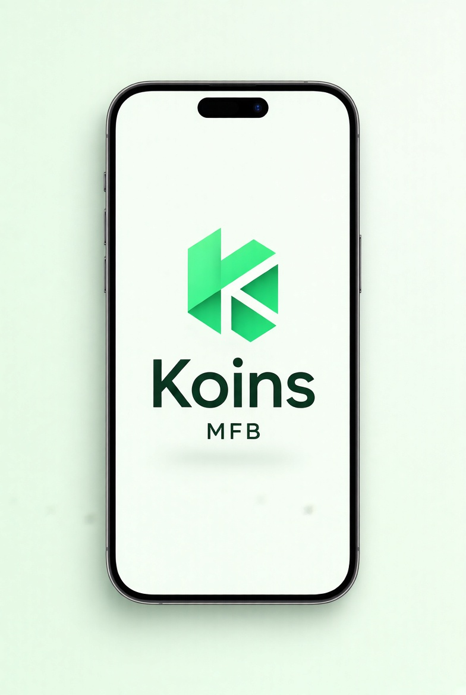

# UI Spec – Splash Screen



> **Reference screenshot** – this is the expected look & feel for the Splash Screen.

> Detailed visual & interaction specification.

---

## Screen Identity

| Item              | Value                                      |
|-------------------|--------------------------------------------|
| Route             | `/` (initial route)                        |
| File              | `features/splash/presentation/screens/splash_screen.dart` (or `lib/screens/splash_screen.dart`) |
| AppBar            | None                                       |
| Safe Area         | Yes                                        |
| Duration          | 1.8 – 2.2 seconds (or until auth check finishes) |
| Next screen       | Login (if not logged in) **or** Dashboard (if session exists) |

---

## Layout Hierarchy

```
Scaffold (background: soft mint #F0FDF4)
└── SafeArea
    └── Center
        └── Column (mainAxisSize: min)
            ├── AppLogo (height: 96–112)
            ├── SizedBox(height: 24)
            └── SizedBox(
                  width: 28,
                  height: 28,
                  child: CircularProgressIndicator(
                    strokeWidth: 2.5,
                    color: primary green,
                  ),
                )
```

---

## Visual Details

### Logo
- Uses the official Koins geometric “K” + wordmark
- Height: 96–112 logical pixels
- Perfectly centered both horizontally and vertically (slight optical lift is fine)

### Loading Indicator
- Small circular progress indicator
- Colour: primary `#22C55E`
- Stroke width: 2.5
- No track colour (or very light mint track)
- Continuously animating while the splash is visible

### Background
- Solid soft mint `#F0FDF4` (same as the rest of the app)
- No gradients or extra decorations

---

## Behaviour

1. App launches → show Splash
2. In parallel:
   - Check local session (`AuthLocalDataSource.isLoggedIn()`)
   - Optional: warm up providers / Hive
3. After minimum 1.8 s **and** session check is complete:
   - If logged in → navigate to Dashboard (clear stack)
   - If not logged in → navigate to Login (clear stack)
4. No user interaction possible on this screen

---

## Acceptance Criteria

- [ ] Logo is perfectly centered
- [ ] Subtle green loading spinner is visible and animating
- [ ] Background matches app theme (`#F0FDF4`)
- [ ] After ~2 seconds (or when ready) navigates correctly based on session
- [ ] No flash of Login/Dashboard before the decision is made
- [ ] Works in both light mode and (future) dark mode

---

## Implementation Notes

- Prefer a simple `StatefulWidget` or a Riverpod-powered splash that listens to an `authProvider` future
- Use `Future.wait([minDelay, sessionCheck])` so the splash never feels too short or too long
- `go_router` redirect or a simple `Navigator.pushReplacement` both work
```
