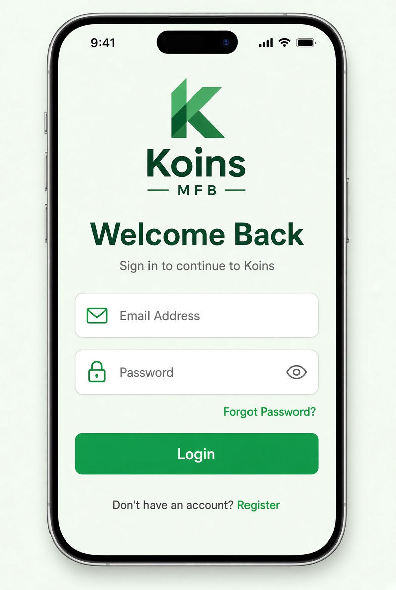

# UI Spec – Login Screen



> **Reference screenshot** – this is the expected look & feel for the Login Screen.

> Detailed visual & interaction specification.  
> Source of truth for implementation and design review.

---

## Screen Identity

| Item              | Value                          |
|-------------------|--------------------------------|
| Route             | `/login`                       |
| File              | `features/auth/presentation/screens/login_screen.dart` |
| AppBar            | None (full-bleed content)      |
| Safe Area         | Yes (top + bottom)             |
| Scrollable        | Yes (SingleChildScrollView)    |
| Keyboard handling | `resizeToAvoidBottomInset: true` |

---

## Layout Hierarchy (top → bottom)

```
SafeArea
└── SingleChildScrollView
    └── Padding (horizontal: 24, vertical: 16)
        └── Column (crossAxisAlignment: center)
            ├── SizedBox(height: 48)                     // top breathing room
            ├── AppLogo (height: 72)
            ├── SizedBox(height: 32)
            ├── Text “Welcome Back”                     // headlineMedium
            ├── SizedBox(height: 8)
            ├── Text “Sign in to continue to Koins”     // bodyMedium, secondary colour
            ├── SizedBox(height: 40)
            ├── Email TextFormField
            ├── SizedBox(height: 16)
            ├── Password TextFormField (with visibility toggle)
            ├── SizedBox(height: 8)
            ├── Align (right) → TextButton “Forgot Password?”
            ├── SizedBox(height: 24)
            ├── PrimaryButton “Login” (full width, height 52)
            ├── SizedBox(height: 24)
            ├── Row (center)
            │   ├── Text “Don’t have an account? ”
            │   └── TextButton “Register”
            └── SizedBox(height: 16)                    // bottom breathing room
```

---

## Visual Details

### Logo
- Widget: `AppLogo`
- Height: 72
- Centered
- Uses `assets/images/koins_logo.png`

### Typography

| Element                    | Style                  | Colour              | Notes                     |
|----------------------------|------------------------|---------------------|---------------------------|
| “Welcome Back”             | headlineMedium (20–24) | textPrimary         | Bold / semi-bold          |
| “Sign in to continue…”     | bodyMedium             | textSecondary       |                           |
| Field labels               | titleSmall / label     | textSecondary       | Floating or above field   |
| “Forgot Password?”         | labelLarge             | primary             |                           |
| “Don’t have an account?”   | bodyMedium             | textSecondary       |                           |
| “Register”                 | labelLarge             | primary             |                           |

### Form Fields

**Email**
- Label: `Email Address`
- Hint: `test@bank.com`
- Keyboard: `TextInputType.emailAddress`
- Autofill: `AutofillHints.email`
- Prefix icon: `Icons.email_outlined` (optional but recommended)
- Validation:
  - Required → “Email is required”
  - Invalid format → “Enter a valid email address”

**Password**
- Label: `Password`
- Hint: `••••••••`
- Keyboard: `TextInputType.visiblePassword`
- Autofill: `AutofillHints.password`
- Obscure text: `true` by default
- Suffix icon: visibility toggle (`Icons.visibility_outlined` / `Icons.visibility_off_outlined`)
- Validation:
  - Required → “Password is required”
  - Length < 8 → “Password must be at least 8 characters”

Both fields:
- Filled: true
- Fill colour: white / surface
- Border radius: 12
- Content padding: horizontal 16, vertical 16
- Error text appears below the field in error colour

### Primary Button (“Login”)

- Full width
- Height: 52
- Background: primary (`#22C55E`)
- Foreground: white
- Border radius: 12
- Text: “Login” (labelLarge, bold)
- **Loading state**:
  - Button disabled
  - Child becomes a small white `CircularProgressIndicator` (strokeWidth 2.5)
  - Text hidden

### Secondary Actions

- “Forgot Password?” → right-aligned TextButton
- “Register” → TextButton next to static text
- Both currently non-functional
- On tap → show SnackBar “Coming soon”

---

## States

| State            | Visual Behaviour                                                                 |
|------------------|----------------------------------------------------------------------------------|
| **Default**      | Fields empty, button enabled, no errors                                          |
| **Validation**   | Red error text under invalid fields, button remains enabled                      |
| **Loading**      | Button shows spinner + disabled, both fields disabled, no other interaction      |
| **Auth Error**   | SnackBar (floating, dark) with message “Invalid email or password”               |
| **Network Error**| SnackBar with message “No internet connection”                                   |
| **Success**      | Navigate to Dashboard (no success snackbar needed)                               |

---

## Interactions

1. User taps **Login**
   - Form validates
   - If invalid → show field errors, stay on screen
   - If valid → call `authProvider.login(email, password)`
2. On success → persist session + `context.go('/dashboard')` (or pushReplacement)
3. On failure → show appropriate SnackBar
4. “Forgot Password?” / “Register” → SnackBar “Coming soon”
5. Password visibility toggle works independently of form state

---

## Spacing Tokens (must use)

```dart
AppSpacing.screenPadding   // 20–24 horizontal
AppSpacing.md              // 16
AppSpacing.lg              // 24
AppSpacing.xl              // 32
AppSpacing.xxl             // 48 (top logo space)
```

---

## Accessibility & Edge Cases

- All interactive elements ≥ 48 dp touch target
- Fields support system autofill
- Keyboard pushes content up (no overflow)
- Long error messages wrap correctly
- Landscape / small screens: content remains scrollable
- Dark status bar icons (light background)

---

## Acceptance Criteria (UI)

- [ ] Logo is centered and correctly sized
- [ ] “Welcome Back” + subtitle hierarchy is clear
- [ ] Both fields have correct keyboard type and autofill
- [ ] Password visibility toggle works
- [ ] Validation messages appear under the correct field
- [ ] Login button shows spinner and is disabled while loading
- [ ] Success navigates to Dashboard and clears the back stack
- [ ] Wrong credentials show the exact error SnackBar
- [ ] Forgot Password & Register show “Coming soon”
- [ ] Screen is fully scrollable when keyboard is open
- [ ] Uses only theme colours and AppSpacing constants (no magic numbers)

---

## Implementation Notes

- Prefer `Form` + `GlobalKey<FormState>`
- Use `TextEditingController`s (dispose them)
- Listen to `authProvider` with `ref.watch` / `ref.listen` for side-effects (SnackBar + navigation)
- Keep the widget tree shallow – extract `_EmailField`, `_PasswordField`, `_LoginButton` if the build method grows past ~80 lines
```
