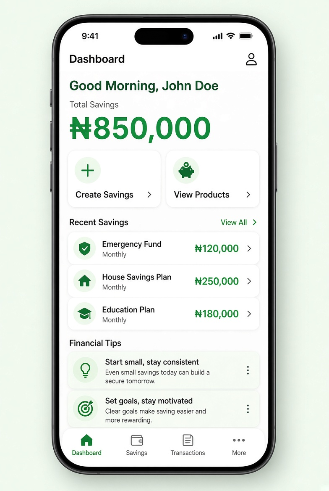

# UI Spec – Dashboard Screen



> **Reference screenshot** – this is the expected look & feel for the Dashboard Screen.

> Detailed visual & interaction specification.

---

## Screen Identity

| Item              | Value                                      |
|-------------------|--------------------------------------------|
| Route             | `/dashboard`                               |
| File              | `features/dashboard/presentation/screens/dashboard_screen.dart` |
| AppBar            | Yes – title “Dashboard”, optional profile icon |
| Safe Area         | Handled by Scaffold                        |
| Scrollable        | Yes (`CustomScrollView` or `ListView`)     |
| Pull-to-refresh   | Optional (bonus)                           |

---

## Layout Hierarchy (top → bottom)

```
Scaffold
├── AppBar
│   ├── Title: “Dashboard”
│   └── actions: IconButton (person) → Profile
└── RefreshIndicator (optional)
    └── CustomScrollView / ListView
        ├── Padding (horizontal: 20)
        │   └── Column
        │       ├── SizedBox(height: 8)
        │       ├── Greeting text                     // “Good Morning, John Doe”
        │       ├── SizedBox(height: 4)
        │       ├── Total Savings label               // “Total Savings”
        │       ├── Total Savings value               // “₦850,000” (large, bold)
        │       ├── SizedBox(height: 24)
        │       ├── Quick Actions row
        │       │   ├── QuickActionCard “Create Savings”
        │       │   └── QuickActionCard “View Products”
        │       ├── SizedBox(height: 32)
        │       ├── Section header “Recent Savings”
        │       ├── SizedBox(height: 12)
        │       └── Recent Savings list (3 cards)
        ├── SizedBox(height: 32)
        ├── Section header “Financial Tips”
        ├── SizedBox(height: 12)
        └── Tips list (2–3 cards)                     // from real API
```

---

## Visual Details

### AppBar
- Background: surface (white)
- Elevation: 0 (scrolledUnderElevation: 1)
- Title left-aligned, titleLarge / 18 sp semi-bold
- Trailing: `Icons.person_outline` → navigates to Profile

### Greeting
- Text: dynamic  
  `Good Morning / Afternoon / Evening, {user.fullName}`
- Style: titleLarge / 18 sp, textPrimary
- Time logic:
  - 05:00–11:59 → Morning
  - 12:00–16:59 → Afternoon
  - 17:00–04:59 → Evening

### Total Savings Block
- Label: “Total Savings” – bodyMedium, textSecondary
- Value: “₦850,000” – displayMedium / 28–32 sp, bold, textPrimary (or primary green)
- Optional subtle card / container with soft mint background

### Quick Action Cards (Row of 2)

Each card:
- Flex: 1
- Height: ~96–104
- Background: white
- Border radius: 16
- Border: 1 px outline or very soft shadow
- Padding: 16
- Content (Column, centered or start):
  - Icon (24–28) in a soft green circle
  - SizedBox(8)
  - Label (titleSmall / 14 sp semi-bold)

| Card            | Icon                        | Action                     |
|-----------------|-----------------------------|----------------------------|
| Create Savings  | `Icons.add_circle_outline`  | → Create Savings screen    |
| View Products   | `Icons.savings_outlined`    | → Products screen          |

### Section Headers
- Style: titleMedium / 16 sp semi-bold
- Colour: textPrimary
- Optional trailing “See all” (not required for v1)

### Recent Savings Cards

Each card:
- Full width
- Background: white
- Border radius: 12–16
- Padding: 16
- Margin bottom: 12
- Content (Row or Column):
  - Leading: small coloured circle / icon
  - Plan name (titleSmall, bold)
  - Amount (titleMedium, primary green) – e.g. ₦120,000
  - Frequency (bodySmall, textSecondary) – e.g. Monthly

**Empty state** (when no plans exist):
- Icon + “No savings plans yet”
- Subtitle: “Create your first plan to get started”
- Optional CTA button “Create Savings”

### Financial Tips Cards (API section)

Each tip card:
- Full width
- Soft background or white with left accent bar (primary green)
- Title (titleSmall)
- Body (bodySmall, max 2–3 lines, overflow ellipsis)
- Loading: 2–3 shimmer / placeholder cards
- Error: inline ErrorState with Retry button (does **not** block the rest of the dashboard)

---

## States

| State                    | Behaviour                                                                 |
|--------------------------|---------------------------------------------------------------------------|
| **Initial / Loading**    | Full-screen or section loading indicators for tips + recent plans         |
| **Loaded**               | All sections populated                                                    |
| **Empty Recent Savings** | Show empty state card in that section only                                |
| **Tips Error**           | Inline error + Retry inside the Tips section only                         |
| **Network Error (global)**| Banner or SnackBar (from connectivity layer)                             |

---

## Interactions

1. Tap **Create Savings** quick action → `/create-savings`
2. Tap **View Products** quick action → `/products`
3. Tap profile icon → `/profile`
4. Tap a Recent Savings card → optional (do nothing for v1 or navigate to details)
5. Pull-to-refresh (bonus) → reload plans + tips
6. Retry on Tips error → call `dashboardProvider.loadDashboard()` again

---

## Spacing Tokens

```dart
AppSpacing.screenPadding   // 20
AppSpacing.sm              // 8
AppSpacing.md              // 16
AppSpacing.lg              // 24
AppSpacing.xl              // 32
```

---

## Acceptance Criteria (UI)

- [ ] Greeting changes correctly with time of day and shows user name
- [ ] Total Savings displays ₦850,000 with proper formatting
- [ ] Two quick-action cards are equal width and tappable
- [ ] Exactly three recent savings cards shown on first launch (seed data)
- [ ] Empty state appears when no plans exist
- [ ] Financial Tips section loads from real API and shows 2–3 items
- [ ] Tips section has its own loading & error UI (does not block whole screen)
- [ ] Profile icon in AppBar navigates correctly
- [ ] All currency values use ₦ + thousand separators
- [ ] Uses theme colours and AppSpacing only

---

## Implementation Notes

- Use `ref.watch(dashboardProvider)` for the main state
- Use `ref.watch(authProvider)` (or a select) only for the user name
- Keep Recent Savings and Tips as separate widgets for readability
- Prefer `SliverList` / `CustomScrollView` if you want a sticky header later
```
