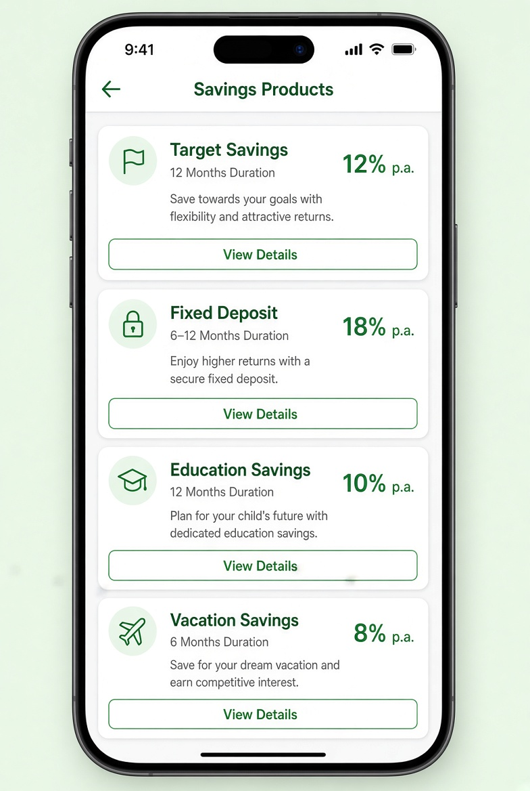

# UI Spec – Savings Products Screen



> **Reference screenshot** – this is the expected look & feel for the Products Screen.

> Detailed visual & interaction specification.

---

## Screen Identity

| Item              | Value                                          |
|-------------------|------------------------------------------------|
| Route             | `/products`                                    |
| File              | `features/products/presentation/screens/products_screen.dart` |
| AppBar            | Yes – title “Savings Products”, back button    |
| Safe Area         | Handled by Scaffold                            |
| Scrollable        | Yes (`ListView.builder`)                       |
| Search / Filter   | Optional (bonus)                               |

---

## Layout Hierarchy

```
Scaffold
├── AppBar (“Savings Products”)
└── body
    ├── (optional) Search bar
    └── ListView.builder
        └── Padding (horizontal: 20, vertical: 8)
            └── ProductCard (one per product)
```

---

## Product Card Design

```
Card / Container
├── Padding (16)
└── Column (crossAxisAlignment: start)
    ├── Row
    │   ├── Icon (in soft green circle)          // product-specific or generic savings icon
    │   ├── SizedBox(width: 12)
    │   └── Expanded
    │       ├── Product Name (titleMedium, bold)
    │       └── Duration (bodySmall, textSecondary)
    ├── SizedBox(height: 12)
    ├── Interest Rate                            // “12% p.a.” – titleLarge, primary green
    ├── SizedBox(height: 8)
    ├── Short Description (bodyMedium, max 2 lines)
    ├── SizedBox(height: 16)
    └── Align (right or full width)
        └── OutlinedButton / TextButton “View Details”
```

### Visual Tokens

| Element            | Value                                      |
|--------------------|--------------------------------------------|
| Card radius        | 16                                         |
| Card padding       | 16                                         |
| Card margin bottom | 12–16                                      |
| Interest colour    | primary (`#22C55E`)                        |
| Icon circle size   | 44–48                                      |
| Icon size          | 24                                         |

### Product-specific icons (recommended)

| Product            | Icon suggestion                  |
|--------------------|----------------------------------|
| Target Savings     | `Icons.flag_outlined`            |
| Fixed Deposit      | `Icons.lock_outline`             |
| Education Savings  | `Icons.school_outlined`          |
| Vacation Savings   | `Icons.flight_outlined`          |

---

## States

| State     | Visual                                      |
|-----------|---------------------------------------------|
| Loading   | Centered `LoadingIndicator` or 4 shimmer cards |
| Success   | List of 4 ProductCards                      |
| Empty     | EmptyState (“No products available”)        |
| Error     | ErrorState + Retry button                   |

---

## Interactions

1. Tap card **or** “View Details” → navigate to `/products/:id` (or pass product object)
2. Back button → Dashboard
3. Retry on error → reload products

---

## Acceptance Criteria (UI)

- [ ] Exactly 4 product cards rendered
- [ ] Interest rate is visually prominent (green + larger text)
- [ ] Short description truncates cleanly
- [ ] “View Details” button is clearly tappable
- [ ] Loading, empty and error states are implemented
- [ ] Consistent card height / spacing
- [ ] Uses theme + AppSpacing only

---

## Implementation Notes

- Data comes from `productsProvider`
- Prefer `ListView.builder` even though the list is small (good habit)
- Extract `ProductCard` into `features/products/presentation/widgets/product_card.dart`
```
