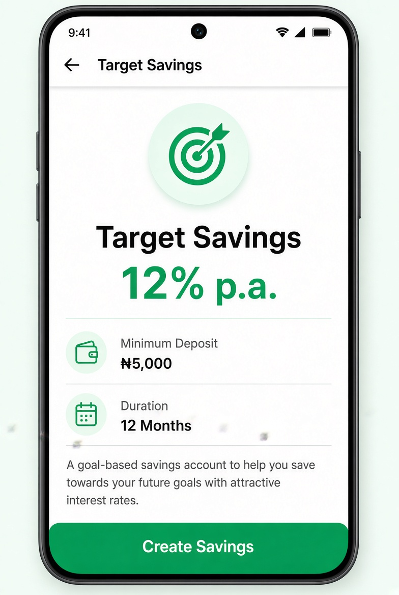

# UI Spec – Savings Product Details Screen



> **Reference screenshot** – this is the expected look & feel for the Product Details Screen.

> Detailed visual & interaction specification.

---

## Screen Identity

| Item              | Value                                                |
|-------------------|------------------------------------------------------|
| Route             | `/products/:id`                                      |
| File              | `features/products/presentation/screens/product_details_screen.dart` |
| AppBar            | Yes – title = product name (or “Plan Details”), back |
| Safe Area         | Handled by Scaffold                                  |
| Scrollable        | Yes                                                  |

---

## Layout Hierarchy

```
Scaffold
├── AppBar
└── body
    └── SingleChildScrollView
        └── Padding (horizontal: 20, vertical: 16)
            └── Column (crossAxisAlignment: start)
                ├── Header section (optional icon + name)
                ├── SizedBox(height: 24)
                ├── Detail row: Interest Rate
                ├── Detail row: Minimum Deposit
                ├── Detail row: Duration
                ├── SizedBox(height: 16)
                ├── Description (bodyMedium)
                ├── Spacer / SizedBox(height: 48)
                └── PrimaryButton “Create Savings” (full width)
```

---

## Visual Details

### Header
- Large product name (headlineMedium / 24 sp bold)
- Optional large icon in soft green circle (64–72)
- Interest rate badge or prominent text underneath

### Detail Rows

Each row is a simple key-value pair:

```
Row
├── Text (label) – bodyMedium, textSecondary
└── Spacer
└── Text (value) – titleMedium, textPrimary (or primary for interest)
```

| Label             | Example Value     | Highlight          |
|-------------------|-------------------|--------------------|
| Interest Rate     | 12% p.a.          | primary green      |
| Minimum Deposit   | ₦5,000            | normal             |
| Duration          | 12 Months         | normal             |

### Description
- Full shortDescription from the product model
- bodyMedium, textSecondary, line height 1.5

### Primary Button
- Full width, height 52
- Label: “Create Savings”
- On press → navigate to Create Savings screen **with product pre-selected**

---

## States

| State     | Behaviour                                      |
|-----------|------------------------------------------------|
| Loading   | Centered LoadingIndicator                      |
| Success   | Full content                                   |
| Error     | ErrorState (“Product not found”) + back button |

---

## Interactions

1. “Create Savings” → `/create-savings?productId=xxx` (or pass object)
2. Back → Products list

---

## Acceptance Criteria (UI)

- [ ] All required fields displayed: Name, Interest, Min Deposit ₦5,000, Duration
- [ ] Interest rate stands out
- [ ] “Create Savings” button is prominent and full-width
- [ ] Navigates to Create screen with product pre-filled
- [ ] Handles unknown product id gracefully
- [ ] Uses theme + AppSpacing only

---

## Implementation Notes

- Receive product either via route argument or by id lookup from `productsProvider`
- Keep the widget simple – no need for complex state beyond loading the single product
```
