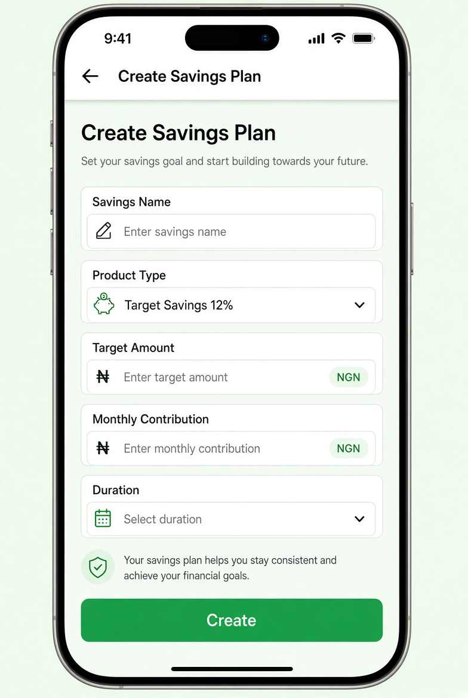

# UI Spec – Create Savings Screen



> **Reference screenshot** – this is the expected look & feel for the Create Savings Screen.

> Detailed visual & interaction specification.

---

## Screen Identity

| Item              | Value                                                |
|-------------------|------------------------------------------------------|
| Route             | `/create-savings` (optional query: `?productId=`)    |
| File              | `features/savings/presentation/screens/create_savings_screen.dart` |
| AppBar            | Yes – title “Create Savings Plan”, back button       |
| Safe Area         | Handled by Scaffold                                  |
| Scrollable        | Yes (`SingleChildScrollView`)                        |
| Keyboard handling | `resizeToAvoidBottomInset: true`                     |

---

## Layout Hierarchy

```
Scaffold
├── AppBar (“Create Savings Plan”)
└── body
    └── SingleChildScrollView
        └── Padding (horizontal: 20, vertical: 16)
            └── Form
                └── Column
                    ├── Savings Name field
                    ├── SizedBox(16)
                    ├── Product Type dropdown
                    ├── SizedBox(16)
                    ├── Target Amount field
                    ├── SizedBox(16)
                    ├── Monthly Contribution field
                    ├── SizedBox(16)
                    ├── Duration field (or dropdown)
                    ├── SizedBox(32)
                    └── PrimaryButton “Create”
```

---

## Form Fields

| Field                  | Type              | Keyboard          | Validation                          | Notes                                      |
|------------------------|-------------------|-------------------|-------------------------------------|--------------------------------------------|
| Savings Name           | TextFormField     | text              | Required                            | Hint: “e.g. Emergency Fund”                |
| Product Type           | DropdownButtonFormField | —            | Required                            | Options from products list                 |
| Target Amount          | TextFormField     | number / decimal  | Required + > 0                      | Prefix: ₦                                  |
| Monthly Contribution   | TextFormField     | number / decimal  | Required + > 0                      | Prefix: ₦                                  |
| Duration               | TextFormField or Dropdown | text      | Required                            | Can be free text or fixed options          |

### Field Styling (all)
- Outlined, filled white
- Border radius 12
- Content padding 16
- Error text under field

### Dropdown (Product Type)
- Items: the 4 products (name + interest)
- When navigated from Details → pre-select the matching product
- Display: “Target Savings (12%)”

### Amount Fields
- `inputFormatters`: FilteringTextInputFormatter for digits / decimal
- Visual prefix “₦” (either in decoration or as leading widget)

---

## Primary Button

- Full width, height 52
- Label: “Create”
- Loading state: spinner + disabled
- Disabled while form is invalid (optional UX improvement)

---

## States

| State            | Behaviour                                                                 |
|------------------|---------------------------------------------------------------------------|
| Default          | Empty form (or product pre-selected)                                      |
| Validation Error | Red messages under invalid fields                                         |
| Loading          | Button spinner, form disabled                                             |
| Success          | SnackBar “Savings Created Successfully” → pop to Dashboard                |
| Network / Server | SnackBar with error message                                               |

---

## Interactions

1. User fills form and taps **Create**
2. Form validates → if invalid, show field errors
3. If valid → call `savingsProvider.createPlan(...)`
4. On success:
   - Show floating SnackBar “Savings Created Successfully”
   - Navigate back to Dashboard (pop until dashboard or `context.go('/dashboard')`)
5. Back button → previous screen (Products or Dashboard)

---

## Acceptance Criteria (UI)

- [ ] All 5 fields present and required
- [ ] Product dropdown populated from real products list
- [ ] Product is pre-selected when coming from Details
- [ ] Amount fields accept only numbers and show ₦
- [ ] Validation messages appear correctly
- [ ] Loading state disables the button and shows spinner
- [ ] Success shows exact message and returns to Dashboard
- [ ] Created plan later appears in Dashboard “Recent Savings”
- [ ] Keyboard does not cause overflow
- [ ] Uses theme + AppSpacing only

---

## Implementation Notes

- Use `Form` + `GlobalKey<FormState>`
- Controllers for text fields, dispose them
- Listen to `savingsProvider` for side-effects (SnackBar + navigation)
- When `productId` is passed, set the dropdown initial value in `initState` or via provider
```
