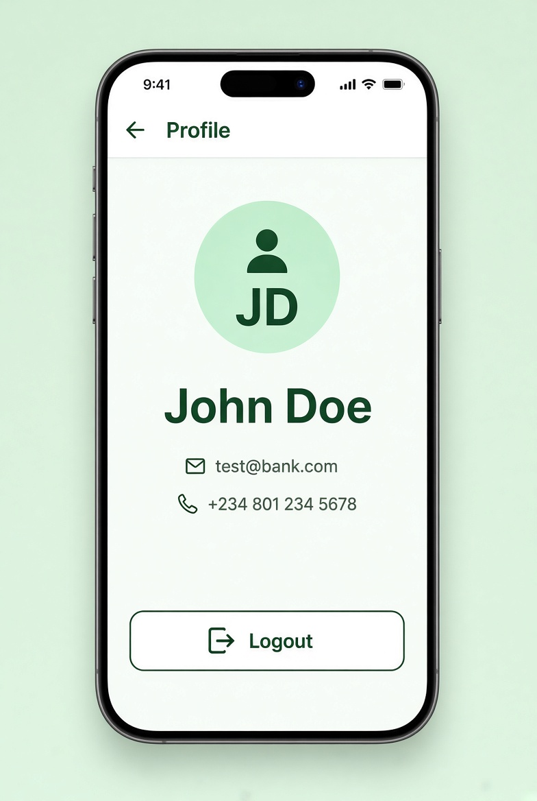

# UI Spec – Profile Screen



> **Reference screenshot** – this is the expected look & feel for the Profile Screen.

> Detailed visual & interaction specification.

---

## Screen Identity

| Item              | Value                                          |
|-------------------|------------------------------------------------|
| Route             | `/profile`                                     |
| File              | `features/auth/presentation/screens/profile_screen.dart` (or dedicated profile feature) |
| AppBar            | Yes – title “Profile”, back button             |
| Safe Area         | Handled by Scaffold                            |
| Scrollable        | Optional (content is short)                    |

---

## Layout Hierarchy

```
Scaffold
├── AppBar (“Profile”)
└── body
    └── Padding (horizontal: 20, vertical: 24)
        └── Column (crossAxisAlignment: center)
            ├── Avatar / Initials circle (radius 48)
            ├── SizedBox(height: 20)
            ├── Full Name (headlineMedium / 22–24 sp bold)
            ├── SizedBox(height: 8)
            ├── Email (bodyMedium, textSecondary)
            ├── SizedBox(height: 4)
            ├── Phone (bodyMedium, textSecondary)
            ├── Spacer()
            ├── OutlinedButton or TextButton “Logout”
            └── SizedBox(height: 16)
```

---

## Visual Details

### Avatar
- CircleAvatar radius 48
- Background: primaryContainer (soft mint)
- Child: Text with initials (“JD”) **or** `Icons.person` (size 40, primary colour)
- Optional thin border

### Text Hierarchy
| Element     | Style              | Colour         |
|-------------|--------------------|----------------|
| Full Name   | headlineMedium     | textPrimary    |
| Email       | bodyMedium         | textSecondary  |
| Phone       | bodyMedium         | textSecondary  |

### Logout Button
- Preferred: OutlinedButton (full width or centered, height 52)
- Alternative: TextButton in error/red colour
- Label: “Logout”
- Icon: `Icons.logout` (optional leading)

---

## Data Source

All values come from the currently logged-in `AuthUser`:

- fullName → “John Doe”
- email → “test@bank.com”
- phone → “+234 801 234 5678”

---

## Interactions

1. Tap **Logout**
   - Call `authProvider.logout()`
   - Clear local session
   - Navigate to Login **and clear the entire navigation stack**  
     (`context.go('/login')` or `pushAndRemoveUntil`)
2. Back button → Dashboard

---

## States

| State     | Behaviour                                      |
|-----------|------------------------------------------------|
| Loaded    | Show user data                                 |
| Loading   | Optional small spinner while logging out       |
| Error     | Unlikely; show SnackBar if logout fails        |

---

## Acceptance Criteria (UI)

- [ ] Avatar / initials displayed
- [ ] Full Name, Email, Phone shown correctly
- [ ] Logout button is clearly visible
- [ ] Logout clears session and returns to Login (no back stack)
- [ ] Uses theme colours and AppSpacing only
- [ ] Layout remains balanced on tall and short screens (Spacer helps)

---

## Implementation Notes

- Watch `authProvider` for the current user
- Keep the screen deliberately simple – no edit functionality required by the assessment
- Prefer `go_router`’s `context.go('/login')` to reset the stack cleanly
```
